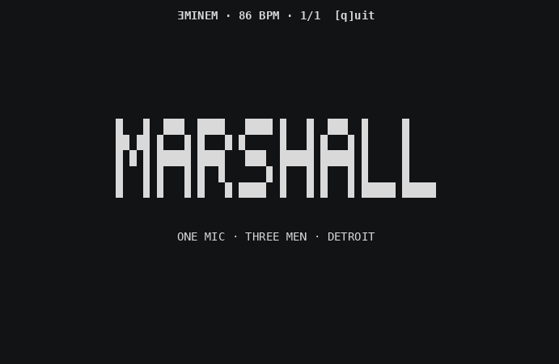

# terminal-art

Animated ASCII art for the terminal. Pure Python 3 + curses — the art pieces have
zero dependencies beyond the standard library.



## Pieces

| Piece | Command | What it is |
| --- | --- | --- |
| hologram | `art hologram` | Rotating 3D wireframe cube with holographic scanline effects |
| ourman | `art ourman [bpm]` | 140 BPM deep-dubstep bass visualizer — throbbing sub-bass orb, radiating bass rings, tribal spectrum analyzer |
| city | `art city` | Night city skyline with twinkling stars and lit windows |
| watch | `art watch` | Ambient zen glyph field that breathes with your commit activity and system audio |
| eminem | `art eminem [bpm]` | One mic, three men — MARSHALL → SLIM SHADY → ƎMINEM block-letter marquee pulsing at 86 BPM |

Every piece:

- runs on the main screen buffer, so your scrollback survives
- falls back to plain ASCII when the terminal can't render unicode
- adapts to terminal size instead of refusing to run
- quits on `q`, `ESC`, or `Ctrl-C`

## Quick start

Each script runs standalone:

```sh
python3 eminem.py
python3 ourman.py 174   # optional BPM override
```

Or install the `art` command:

```sh
mkdir -p ~/.local/share/art
ln -sf "$(pwd)"/*.py ~/.local/share/art/
```

Then add to your `.zshrc` (or adapt for bash):

```sh
art() {
  local name="${1:-hologram}"
  [[ $# -gt 0 ]] && shift
  local script="$HOME/.local/share/art/${name}.py"
  if [[ ! -f "$script" ]]; then
    echo "Unknown art: $name"
    echo "Available: $(printf '%s\n' ~/.local/share/art/*.py 2>/dev/null | xargs -n1 basename -s .py | tr '\n' ' ')"
    return 1
  fi
  python3 "$script" "$@"
}
```

## Watchers (optional, for `art watch`)

`watch.py` renders a calm ambient field on its own. To make it reactive, run the
two background daemons that feed it state:

- **`commit-watcher.py`** — polls a git repo for commits, branches, tags, and
  stashes; recent activity spawns brighter glyphs, color-coded by path.
  Config: copy `commit-watcher.config.example.json` to a local file and point
  `ART_WATCHER_CONFIG` at it. Standard library only.
- **`audio-watcher.py`** — samples system audio and writes beat/level state so
  the field pulses with your music. Config via `ART_AUDIO_CONFIG`.
  Requires `numpy` and `sounddevice`, plus an audio loopback device
  (e.g. [Background Music](https://github.com/kyleneideck/BackgroundMusic) on macOS).

`watch.py` degrades gracefully when either state file is missing — you just get
the ambient field without that reactivity.

## License

[MIT](LICENSE)
